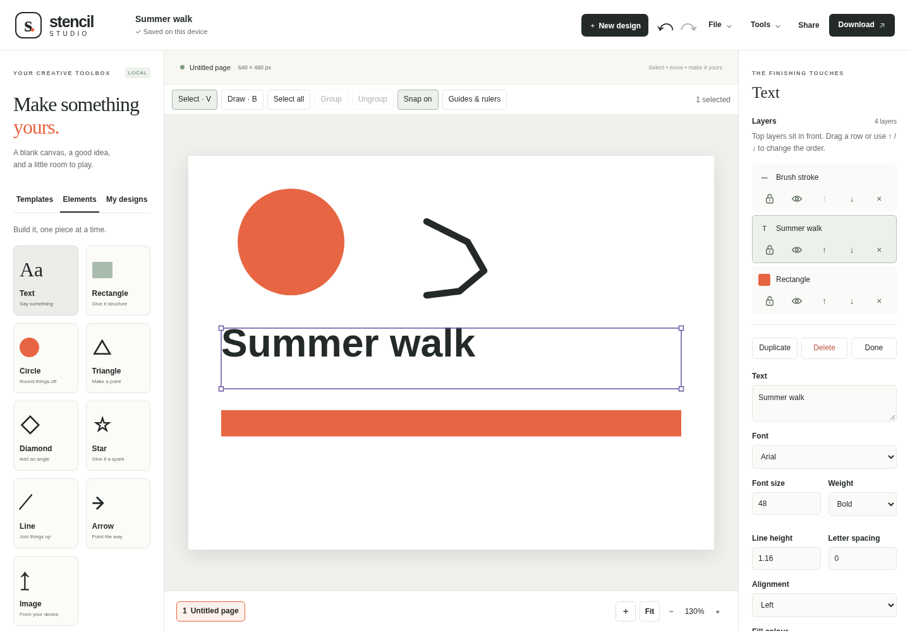

# Stencil Studio

[**Try Stencil Studio**](https://tylerbuilds.github.io/stencil-studio/) · [Linux/macOS checks](https://github.com/tylerbuilds/stencil-studio/actions/workflows/verify.yml)

Make a poster, card, presentation or social graphic in your browser. Start with a blank canvas, make a template your own, or draw something from scratch.



[On a phone](docs/screenshots/design-tools-mobile-0.5.1.png)

## Create your first design

1. Choose **New design**, give it a name and pick a size. Choose **Create design** to open your canvas.
2. Add text, shapes or images from **Elements**. Choose **Draw** to sketch with a brush.
3. Select something on the canvas to change its colour, size or position. Drag the corner handles to resize it.
4. Choose **Download** when it is ready, or **File → Save design** to keep it in **My designs**.

Prefer a starting point? **Templates** has eight original designs, including a poster, card, presentation, story and menu. Starting another design keeps your current work in **My designs** first. If its backup cannot be saved, your current design stays open. Download JSON to keep a copy; starting another design stays blocked until the backup can be saved.

## Add, draw and arrange

Add rectangles, circles, triangles, diamonds, stars, lines and arrows. Resize a circle to make an oval. Select a shape to change its fill and outline. **Draw** uses a round brush; choose a colour and width, then drag on the canvas. Every stroke becomes a layer you can move, resize, recolour or undo. Press **Escape** or choose **Select** when you have finished drawing.

**Layers** shows the frontmost layer at the top. Drag a row or use its arrows to change the order. Lock a layer to keep it in place, or hide it to leave it out of downloads. Shift-click to select several layers, then group them to move or copy them together. Use **Guides & rulers** to line things up; hold **Alt** while dragging to ignore snapping.

Add a table or bar, line or pie chart from **Elements**. Fill in the grid, then reopen **Edit data** whenever you need to change the values. You can also create personalised pages from CSV, such as a set of cards with different names.

The [design guide](docs/consumer-design.md) covers drawing, layers, tables, pages, guides and backups.

## Bring in your own images and text

Choose **Image** or **File → Insert files**, or drop files onto the canvas. Stencil accepts PNG, JPEG, WebP, GIF and plain-text files. You can add up to 20 files in one go and undo the whole insertion at once. Images can be up to 6 MiB each, with an 8 MiB limit for the batch.

Copy and paste layers between Stencil tabs with **Cmd/Ctrl-C** and **Cmd/Ctrl-V**. Click the canvas before pasting text or an image from another app. Text fields keep their usual shortcuts. **Tools** also has Copy, Paste and **Copy page as PNG**; if your browser cannot copy the image, Stencil downloads it instead.

Select an image to crop it or adjust brightness, contrast, colour and blur. **Remove a background colour** makes a solid background transparent. It removes matching colours from the edges, so it works best with a plain background.

See [file and clipboard limits](docs/research/core-workflows.md) for the full list. Canva projects, SVG, PDF and office files cannot be opened as designs.

## Save and download

Your open design saves in this browser. **File → Save design** keeps a named version in **My designs**; **Save a new copy** keeps another version. **File → Save JSON** downloads all pages so you can reopen and edit them in Stencil. Back up the whole library from **My designs** to move it to another browser.

Download the current page as **PNG**, **JPG** or **SVG**, or all pages as **PDF**. Select the empty canvas and turn on **Transparent background** for transparent PNG or SVG output. JPG and PDF use your background colour. The PDF download keeps the layout as images; its text is not selectable. **Print / Save PDF** opens your browser's print dialog instead. Check the result before sharing, since fonts can vary between devices.

**Present** shows your pages as slides. **Video** turns them into a slideshow with cuts or fades and optional audio. Export takes about as long as the video, so keep the tab open. See [making a video](docs/video.md) for steps and limits.

## Keep your work safe

Designs and images stay in this browser unless you download them or use an optional sharing service. There are no accounts or tracking. Clearing browser data can remove saved designs, so keep a JSON backup somewhere safe. Undo works while the tab is open; it is not a saved history. If the browser cannot save, keep the design open and download it.

**Share** and **AI writing** need a configured server and are unavailable on the online demo. Sharing sends the active design to that server and uses separate owner, editor and viewer links. Anyone with a link can use its access level, so keep the owner link private. AI writing sends only the text and direction shown in its window when you ask for a draft. You decide whether to use the result. See [server setup and data handling](docs/self-hosting.md).

## Run on Linux or macOS

Install Node.js **22.19+ or 24.11+**, then run:

```sh
git clone https://github.com/tylerbuilds/stencil-studio.git
cd stencil-studio
npm ci
npm start
```

Open **http://localhost:4202** in a recent browser. Stop the server with **Ctrl-C**. This is a browser app, with no desktop installer.

## Develop and contribute

```sh
npm test
npm run build
npm run preview
npm run test:browser
```

The build goes into `dist/`. Browser checks need Playwright's Chromium installation or a system browser set through `BROWSER_EXECUTABLE`. Linux runners may need `npx playwright install --with-deps chromium`. See [CONTRIBUTING.md](CONTRIBUTING.md), [AGENTS.md](AGENTS.md) and [release checks](docs/verification.md).

Stencil uses independently written code and original designs. It is not affiliated with Canva and does not claim its full feature set. Cloud asset libraries, uploaded fonts, pressure-sensitive brushes, footage editing, team administration and print-production tools are not included. The [feature comparison](docs/research/feature-comparison.md) remains the dated 0.3 audit; [research and REA sources](docs/research/rea-provenance.md) explain its scope.

[MIT licence](LICENSE).
