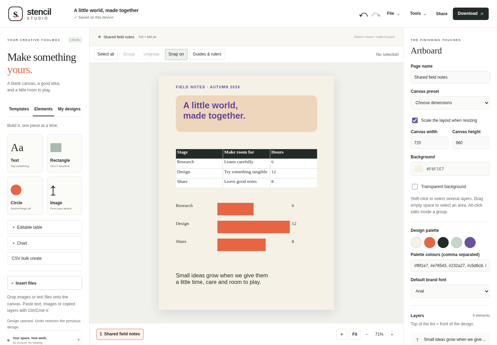

# Stencil Studio

An original, open-source design studio for posters, social graphics, cards and presentations. Edit on your own device, save named designs, turn CSV data into layouts and export real SVG, PNG, JPEG or multi-page PDF.



## Start on Linux or macOS

Install Node.js **22.19+** or **24.11+**, clone this repository and run:

```sh
npm install
npm start
```

Open [Stencil Studio on localhost](http://127.0.0.1:4202). The server binds to your machine by default. `npm run dev` starts the same server. The static [public demo](https://tylerbuilds.github.io/stencil-studio/) runs the local design tools; optional AI writing requires a configured local server.

The editor runs in a modern browser. There is no native desktop installer. See [verification receipts](docs/verification.md) for actual browser, Linux/macOS CI and deployment checks; support and verified execution are separate claims.

## Build a design

Choose from eight original templates: poster, square social graphic, card, two-page presentation, banner, vertical story, résumé or menu. Start blank or use pixel-size presets. When resizing a page, **Scale the layout** proportionally resizes unlocked elements; this is a local scaling tool, not AI reflow.

Add plain text, rectangles, circles or your own PNG/JPEG/WebP/GIF images. **Image** opens a multiple-image chooser; **File → Insert files** or **Elements → Insert files** also accepts UTF-8 text files. Drop files onto the canvas to place them near the drop point. Up to twenty files and 8 MiB combined input form one ordered insertion and one Undo step; each image is limited to 6 MiB, 16,384 pixels per side and 40 megapixels. The entire batch must validate and decode before any layer is inserted. Dropping or inserting one Stencil JSON design asks before replacing the current design and cannot be mixed with other files. File → Open JSON is an explicit open action and keeps its direct-open behaviour. Pending intake cancels if the page, design or editing draft changes, or when you choose another batch or Cancel insertion. Edit dimensions, position, rotation, opacity, outlines, text spacing and fonts. Inspector fields apply when you finish editing a field. The document carries a palette of up to eight colours and a default font; swatches apply to the selection or artboard.

Shift-click layers or objects to select several. Drag empty space for a marquee selection. Group and ungroup layers, then move, duplicate, copy or paste them together. **Alt-click** edits one object inside a group. Align a selection to its combined bounds or the page; distribute independent objects or groups evenly. Drag snapping uses page and neighbouring object edges and centres; hold **Alt** while dragging to bypass it. Lock protects a layer and its group; hiding removes a layer from presentation and exports.

Image crops use percentages of the source image. Change crop width/height before moving the crop's left/top edge so it stays inside the image. Brightness, contrast, saturation, grayscale and blur are reversible SVG filters, saved in JSON and rendered through the same exporter as the preview. **Remove a background colour** produces a real transparent PNG using edge-connected colour matching. It works on solid backgrounds and does not perform AI subject segmentation.

Add a **table** or **chart** from **Elements**. The data editor keeps the source values in the design: edit cells, add or remove rows, and reopen **Edit data** from the inspector. Tables support up to eight columns and fifty data rows, with editable header, text, fill and border styles. Charts support bar, line and pie views of one dataset with up to thirty labels and non-negative values. Switching chart type keeps the values; pie charts require a positive total. Paste quoted CSV in the expandable CSV panel, load it into the grid, then save. Older table/chart groups remain ordinary editable layers; migration does not guess their lost source data.

Use **Page order** in the inspector to move the current page earlier, later or to an exact numbered position. The active page, layer IDs and content stay together; Undo restores its previous position. **Guides & rulers** controls persistent horizontal/vertical guides, ruler visibility, snapping sources and a 1–30 screen-pixel snap distance. Add a fractional canvas-pixel coordinate in the dialog, click a ruler or drag a guide. Guide coordinates scale with **Scale the layout** when resizing; otherwise they clamp to the new page bounds. Guides and rulers never appear in exports. Hold Alt while dragging layers to temporarily bypass snapping.

## Save, create in bulk and present

The header keeps document actions in **File**, presentation/video/AI actions in **Tools**, and output formats in **Download**. The menus work with keyboard focus, Enter and Escape.

**File → Save design** adds or updates a named entry in **My designs**. Open, duplicate or delete saved entries, save a new copy, and back up the whole library as JSON. Library imports validate every record before a single write; an exact duplicate is skipped and conflicting IDs cannot silently overwrite a saved design. The library supports up to twenty designs; actual browser storage can fill sooner than the validated file limit.

For bulk creation, put `{{column}}` placeholders in text or a page name, then open **CSV bulk create** and supply matching headers. A CSV with `name,message` can fill `Hello {{name}}` and `{{message}}`. Up to thirty data rows create thirty independent pages from the current page. Quoted commas, quotes and line breaks are supported. CSV cells are literal text, not executable formulas, URLs or markup.

**Present** displays design pages in a slideshow with arrow navigation and optional full screen. **PNG**, **JPG** and **SVG** download the current page. With no layer selected, enable **Transparent background** in Artboard properties for a genuinely transparent PNG or SVG. The checkerboard is an editor preview and is never exported. JPEG and raster PDF flatten transparent areas to the retained Background colour; printed pages use the paper background. **PDF** downloads every page as raster artwork at 96 pixels per inch; text in that PDF is not selectable and it is not a CMYK/bleed/print-production export. **Print / Save PDF** separately opens the browser's all-page print workflow. Fonts depend on your system and SVG word wrapping is approximate, so inspect the result before sharing it.

**Save JSON** exports all pages as an editable Stencil Studio document. Imports accept strictly validated v1, v2 and v3 documents; earlier designs migrate to v3 while preserving their existing fields, IDs, page order and artwork. New saves use v3 and cannot be read by the older v2 app. Before replacing an older active save or library, the app keeps its exact original JSON bytes under a separate local migration-backup key. If that backup cannot be written and verified, replacement is blocked and the original remains intact. Use **Recovery data** from File when offered, and export the current JSON for your new work. Canva projects cannot be imported. Document files are limited to 12 MiB of UTF-8 JSON, CSV to 1 MiB, images to 6 MiB before encoding and library backups to 18 MiB. Designs support thirty pages, three hundred elements per page and one thousand elements overall; artboard dimensions are 64–4,096 pixels.

The open document and library live in browser local storage. Clearing browser data, changing ports or moving browsers does not carry them across. Export JSON for a portable backup. Storage errors keep the current design open and report that a backup is needed. Undo/redo covers the current session; it is not durable version history.

## Local video and optional shared workspaces

**Video** turns the design's pages into a real scene timeline. Set 0.25–30 seconds per page, choose cuts or crossfades, prepare a visual preview and play, pause or seek it. Export records the canvas in real time; keep the tab active. An optional local audio file is included in the rendered output. Supported containers are detected from the browser: WebM is preferred and MP4 is offered only when the browser can actually record it. The result downloads and can be played in the dialog. Cancel releases the render resources. The full limits and verification procedure are in [video documentation](docs/video.md). This is a page-scene renderer, not a footage-trimming or multi-track animation editor. Timing, transitions and audio belong to the export session and are not saved in design JSON.

**Share** checks for an explicitly configured self-hosted workspace server. When enabled, create a shared design with distinct owner, editor and viewer access links. Save edits to the server, receive remote revision updates, add comments, restore a stored revision, and enable or revoke editor/viewer capabilities. Concurrent stale writes report a revision conflict and retain local edits until you deliberately refresh. View-only sessions block mutations; disconnect to keep an independently editable local copy. Access tokens live in URL fragments and are bearer capabilities: keep owner links private. Shared documents, revisions and comments are durable server data; the static demo has no collaboration backend. This is versioned shared editing with polling and conflict detection, not a claim of Canva's collaboration algorithm or team administration.

## Optional real AI writing

**AI writing** checks for a configured same-origin local AI bridge. When available, it can rewrite selected copy, translate text or respond to a design brief using a real model. Only the text and direction shown in the dialog are submitted when **Generate** is clicked. Review or edit the candidate, then explicitly apply it to the selected text; Undo restores the earlier version. Cancel stops the request. Design plans remain advice rather than automatically generated layouts.

Static hosting has no inference backend and reports AI unavailable. No browser credentials, simulated model responses or automatic generation are used. Native server credentials remain operator-managed. The core design tools, pixel tools and exports work without AI configuration.

## Keyboard shortcuts

| Action | Shortcut |
| --- | --- |
| Move selection / move ten pixels | Arrow keys / Shift + arrows |
| Delete selection | Delete / Backspace |
| Undo / redo | Cmd/Ctrl-Z / Shift-Cmd/Ctrl-Z or Ctrl-Y |
| Copy / paste layers between Stencil tabs; paste external text/images | Cmd/Ctrl-C / Cmd/Ctrl-V |
| Duplicate | Cmd/Ctrl-D |
| Select unlocked visible objects | Cmd/Ctrl-A |
| Group / ungroup | Cmd/Ctrl-G / Shift-Cmd/Ctrl-G |
| Deselect | Escape |

Text fields and open dialog forms retain their normal editing shortcuts. Click the canvas before pasting external text or images. Selected layers use the real system clipboard: their validated Stencil data, relative positions, groups, crops and editable chart/table values survive a paste into another Stencil tab. Other applications receive the portable JSON text rather than editable Stencil objects. External URLs and markup in plain text remain literal text; HTML-only content, SVG files, PDFs and office documents are not imported.

**Tools → Copy layers** and **Paste** provide explicit clipboard buttons on supported secure pages with browser permission. If reading is unavailable or denied, use the keyboard shortcuts; no automatic clipboard reads occur. **Copy page as PNG** copies the current page as an image for another application when supported, and otherwise downloads a real PNG. Clipboard capabilities and permissions vary by browser; the [clipboard and file-intake notes](docs/research/core-workflows.md) separate this implementation from native runtime qualification.

## Build and verify

```sh
npm test
npm run build
npm run preview
npm run test:browser
```

The static build writes `dist/`. Runtime dependencies remain empty; Playwright is a development-only browser check. Browser checks require its browser installation or a configured system executable. Stop servers with `Ctrl+C`; use `node scripts/serve.mjs --port 4302` for another port.

## Scope and research

The [next-wave scope and migration notes](docs/research/parity-next.md) describe page order, precise guides, transparent exports and retained data elements. The [source-linked parity ledger](docs/research/parity-ledger.md) and [all-tier source comparison](docs/research/feature-comparison.md) record delivered, partial, remaining and unknown behaviours across Canva's free and premium workflows. The [original feature map](docs/research/feature-map.md) preserves the first release's observations. [REA](https://github.com/morluto/rea), pinned to `6ce3288`, supplied bounded public investigation; [provenance](docs/research/rea-provenance.md) distinguishes captured public evidence from official documentation and unknown authenticated internals.

The all-tier source comparison retains the dated 0.3 audit. Current clipboard and file insertion are described in the [0.4 workflow guide](docs/research/core-workflows.md); that guide does not relabel the full inventory as parity.

This release is not full Canva parity. Canva-scale collaboration, account/team administration, shared brand management, stock asset catalogues, uploaded fonts, rich text effects, semantic background removal, generative photo editing, footage/multi-track animation editing, GIF export, social scheduling, CMYK/bleed/crop marks, PPTX/DOCX and SSO/SCIM remain separate work. MP4 output depends on actual browser recording support. Optional shared workspaces require a configured server and capability links; they are not available on static hosting. Real model-backed writing is conditional on the local bridge; it is not a claim of equivalent Canva AI systems.

Stencil Studio contains independently written code, original layouts and copy. It is not affiliated with Canva and contains no recovered proprietary source. There are no accounts or tracking; model and shared-workspace calls occur only through explicitly configured optional services and deliberate generation/sharing actions. Contributions should preserve these boundaries and validated state. See [AGENTS.md](AGENTS.md) and [CONTRIBUTING.md](CONTRIBUTING.md).

Licensed under [MIT](LICENSE).
