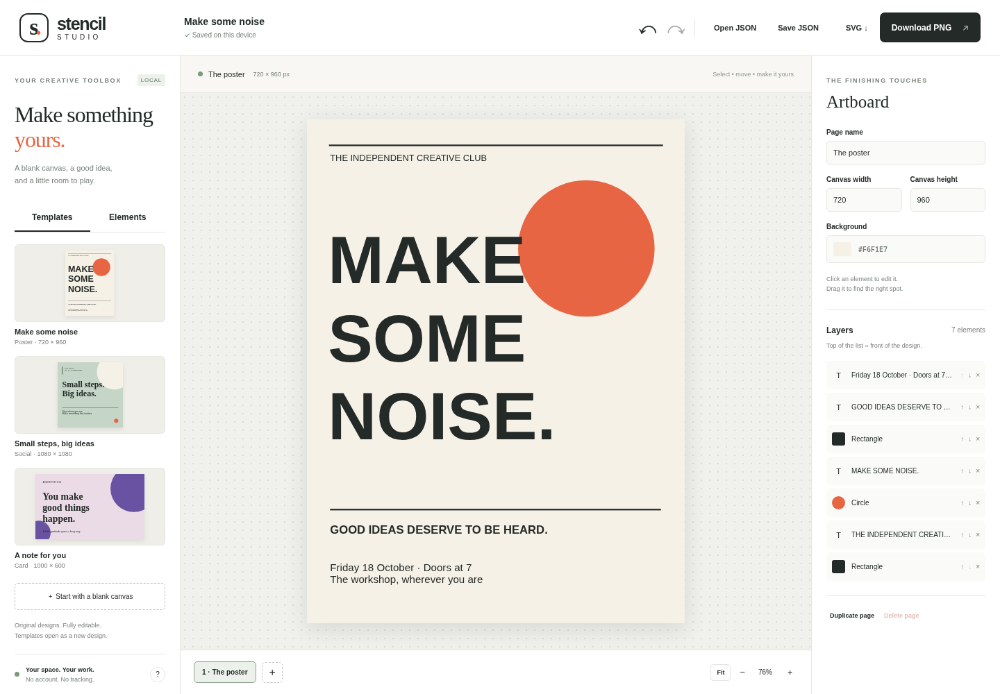

# Stencil Studio



[Try the live demo](https://tylerbuilds.github.io/stencil-studio/) · [Linux/macOS checks](https://github.com/tylerbuilds/stencil-studio/actions/workflows/verify.yml)

An open-source, local-first design editor for posters, social graphics and cards. Build a layout from original templates, shapes, text and your own images, then download SVG or PNG.

## Start on Linux or macOS

Install Node.js **22.19+** or **24.11+**, clone this repository and run:

```sh
npm install
npm start
```

Open [Stencil Studio on localhost](http://127.0.0.1:4202). The server binds to your own machine by default. `npm run dev` starts the same server.

The editor runs in a modern browser on Linux or macOS. There is no native desktop package. Browser and operating-system verification receipts belong in `docs/verification`; browser support is distinct from having tested each platform.

## Make and save a design

1. Choose an original poster, square social graphic or card template.
2. Add text, a rectangle, a circle or a local PNG, JPEG, WebP or GIF image up to 6 MB. Drag an element to move it and use the inspector to edit its position, dimensions, text, font and colour. Inspector changes apply when you finish editing a field.
3. Set the artboard dimensions and background. Reorder or remove elements in the layer list.
4. Add, duplicate, switch or delete pages; a project always keeps at least one page.
5. Use **Undo** and **Redo** to revisit edits. With an element selected, arrow keys move it by one pixel, **Shift** + arrow keys move it by ten pixels, and **Delete** or **Backspace** removes it. **Cmd/Ctrl-Z** undoes; **Shift-Cmd/Ctrl-Z** or **Ctrl-Y** redoes.
6. Export all pages as editable JSON, or download the current page as SVG or PNG. Import project JSON to continue on another machine.

The current project is saved in your browser's local storage. Storage belongs to that browser and site address; clearing browser data, using a different port or moving to another browser does not carry the design across. Export JSON for a portable backup. Imports accept `.json` files up to 12 MB in a validated, versioned Stencil Studio format; they do not import Canva projects. Browser storage may fill sooner than that file limit, particularly with embedded images.

Your uploaded images remain local. The application has no accounts, backend, telemetry, remote fonts, asset service or external network calls. Node serves static files; the browser performs editing and export.

## Build or verify the app

```sh
npm test
npm run build
npm run preview
```

`npm test` runs the state tests with Node's test runner. The build writes a static site to `dist/`; preview serves that build. There are no runtime dependencies. Stop either server with `Ctrl+C`.

To use another local port:

```sh
node scripts/serve.mjs --port 4302
```

## Scope and next steps

This initial release covers multiple pages, three original templates, basic elements, direct positioning, layers, undo/redo, local persistence and JSON/SVG/PNG export. Image exports cover the current page only. It does not include collaboration, cloud storage, stock media, AI generation, video editing, animation, print-ready PDF, advanced image editing, grouping, snapping or a desktop installer. Fonts depend on what your system has installed, so text can differ between machines. GIF input is intended for still layouts; animated output is outside this release.

Projects support up to 30 pages, 300 elements on a page and 1,000 elements overall. Each artboard dimension must be 64–4,096 pixels. Text uses Arial, Georgia or Courier New, with approximate word wrapping; check the exported result before sharing it.

Next steps are batch page export, alignment and snapping, richer text controls, accessible editing improvements, more original templates and further browser/platform verification. These are roadmap items, not current features.

## Public feature research and independent implementation

The [feature map](docs/research/feature-map.md) records public Canva documentation observations, the resulting implementation choices and known gaps. The companion investigation toolkit is [REA](https://github.com/morluto/rea), pinned for this work to `6ce3288`; see [investigation provenance](docs/research/rea-provenance.md) for its revision, scope and reproduction guidance. Stencil Studio contains independently written code and original layouts and copy. It is not affiliated with Canva, does not contain recovered proprietary source and does not claim Canva feature parity.

Contributions should preserve local operation, validate saved/imported state and include original or suitably licensed assets. See [AGENTS.md](AGENTS.md) for contributor guidance.

Licensed under [MIT](LICENSE).

## Browser verification

The runtime has no package dependencies. To run the development browser checks, install the pinned tools and Chromium:

```sh
npm ci
npx playwright install chromium
npm run build
npm run test:browser
```

Linux runners may need `npx playwright install --with-deps chromium` for browser system libraries. `BROWSER_EXECUTABLE=/path/to/chrome npm run test:browser` uses an existing browser. The GitHub workflow runs model tests, a static build and real browser edit/persistence/export checks on both Ubuntu and macOS, then publishes the static demo only after both pass.

[REA investigation provenance](docs/research/rea-provenance.md) records public observations, receipt digests and explicit research limits.
